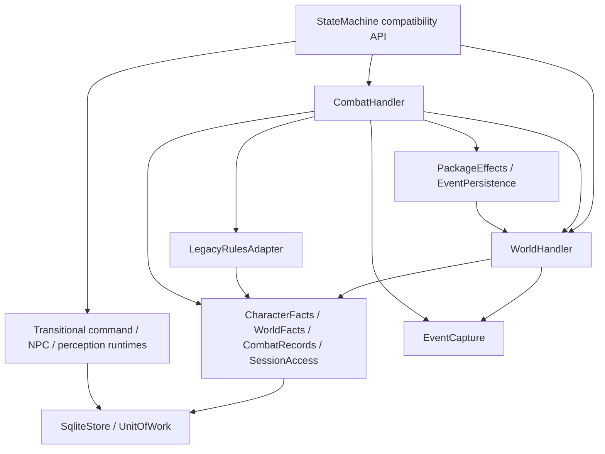

# RF-1: domain runtime and shared commit

2026-10-19 Session follow-up: creation is now coordinated by SessionCreation;
SessionAccess retains identity/grants/pin checks, and SessionRuntime owns execution
metadata plus common version/event publication and receipt completion. Runtime
RE identities come from persisted Session rows. Current ownership and remaining
domain configuration gaps are in [Session Management](SESSION_MANAGEMENT.md).
The RF-1 baseline/schema/check evidence below is historical.

2026-10-18 follow-up: SceneLifecycleService now owns the existing scene
initialization/entry/departure/PC-visit/flag coordination previously in WorldHandler.
The historical RF-1 baseline and verification below remain historical. Current
ownership, admission paths and the bounded W-01 status are recorded in
[Scene lifecycle](SCENE_LIFECYCLE_SERVICE.md) and
[its progress](SCENE_LIFECYCLE_SERVICE_PROGRESS.md). Facts/Records still own data;
this extraction introduces no schema, command protocol or second position store.

Authority: the merged architecture decision `e6cde66` in the orchestration
repository. This document records the bounded implementation in SM, not a new
cross-module contract. Baseline: `802599a`, including GC-1 fix `9e9eac8`.

## Before changing code: write responsibility audit

| Facts | Baseline readers / production writers | RF-1 owner | Commit boundary |
|---|---|---|---|
| actors identity, scene, cell | service initialization; spatial movement; NPC/perception reads | CharacterFacts | caller's shared transaction |
| characters HP, inventory, resources, effects, XP | service/CombatRuntime initialization; synthetic delta; DndRuntime delta | CharacterFacts | rule outcome + world effects + receipt |
| mechanical_actors rules metadata | CombatRuntime initialization; DndRuntime actor delta | CharacterFacts | same rule settlement |
| scene_instances, objects, mechanical_scenes | service/CombatRuntime initialization; spatial placement; service switch/flag | WorldFacts | world operation + evidence + receipt |
| combats lifecycle, ledgers, terminal geometry | CombatRuntime initialization/read; DndRuntime delta | CombatRecords / CombatHandler | same rule settlement |
| sessions ownership, pin, current PC scene, versions | SessionCreation initialization; SessionAccess auth; spatial PC movement; command/rule settlement | SessionRuntime writes; SessionAccess authorizes | shared outer transaction |
| RNG and command receipts | SessionCreation; command/synthetic/Dnd settlement | SessionRuntime, shared store | same outcome, never separate commit |
| frozen evidence, events, Outbox, NPC queue | EventRuntime capture/expand; service append; PerceptionQueueRuntime | stage capture / event persistence | capture at business stage; persist atomically |
| NPC tasks, cognition, modes, schedules, projections | NPC and perception runtimes | transitional existing runtimes | separate existing operation lifecycles |

Audited paths include creation, revisits, compatibility helpers, synthetic
evaluation, Package cascades, CheckWorldEffects, reliable NPC handoff and game
time. Schema migration remains an independent initialization responsibility.

## Baseline evidence

Before refactoring, package/commands/sessions/spatial/door provenance/conditional
effects/real checks/closure/NPC outputs: **288 passed**, 2 existing Lark
deprecation warnings, 65.58 s. This is a baseline, not post-change validation.

## Implemented dependency direction

The work proceeded sequentially: shared storage, current world/character writers,
then combat/rules composition. `StateMachine` no longer inherits SpatialRuntime,
CombatRuntime or DndRuntime. Its world/combat public methods delegate to concrete
components. Unused private forwarding methods were removed; private evaluator,
loader, geometry and fault-injection tests now target their actual owners.

Components receive explicit dependencies, never a StateMachine or a universal
runtime context. There is no service locator, dynamic forwarding or second
current-state cache. `CharacterFacts` owns actor identity/position and mechanical
actor metadata as well as core character facts. `WorldFacts` owns maps, objects,
scene flags/visits and clock. `CombatRecords` owns encounter records and terminal
geometry; `SessionAccess` owns session initialization, authorization, version,
RNG and command receipts. The sole exception for the sessions row is
`EventPersistence` assigning `event_seq` together with durable event identities.
Creation deduplication remains in the existing session creation orchestration.

The owner methods serve both initialization and ordinary operations, including
legacy synthetic HP/resource deltas. Pinned rule metadata updates use explicit
closed field sets, after the original result/pre-value validation. Unknown
fields fail closed. No domain method commits. The AST regression identifies
production SQL writers by table and class, checks their write guards and rejects
reverse dependencies on StateMachine in migrated components.

## Shared operation and evidence boundary

`SqliteStore` retains file SQLite, WAL, FULL synchronization, foreign keys,
cross-process locked migrations, errors and one connection per instance/thread.
Schema remains 21. The legacy `_transaction` delegates to it. UnitOfWork rejects
nested transactions; savepoints implement local rollback. New scope handles
expire, do not expose connections/cursors, reject transaction-control SQL and
deny writes through a read scope. Fact methods also require an active write
scope. The raw connection remains private transitional infrastructure for
unmigrated runtimes; it is not a Host/LLM API.

The combat/check path is:

1. A read transaction verifies session/pins, current control and reliable handoff,
   checks replay and detaches the adapter snapshot and RNG.
2. The adapter builds the pinned request, admits supported capabilities, verifies
   binding and evaluates outside the write transaction. No external wait owns
   the SQLite write lock.
3. One short write transaction rechecks grants, handoff, replay, version, snapshot,
   RNG and the closed result. A savepoint groups character/combat updates,
   conditional world effects and Package effects. `SessionAccess` advances
   version/RNG, `EventPersistence` writes frozen events/evidence/Outbox/queue,
   and the command receipt joins the same outer commit.

World commands and the synthetic rule path retain their corresponding existing
settlement semantics, now using the same store and fact owners. Domain rejection
can roll back a savepoint and retain a refusal receipt. Storage faults roll back
the entire transaction. The existing narrower cascade-limit handling for real
and synthetic rule settlements remains unchanged. Same-key replay, changed
fingerprints, authorization revocation, OCC and committed lost replies remain
covered by existing real SQLite tests.

`EventCapture` reads only at the actual producer stage. Departure precedes
movement; arrival, placement and switching capture after their own mutation.
`EventPersistence` consumes immutable `_StagedEvent` evidence and never samples
the final world. Existing Package cascades and per-NPC proof SQL have a single
implementation. Schema migration invokes that proof helper only while locked;
normal event persistence requires the active write scope. Existing evidence
uncertainty, barriers, queue ordering and watermarks remain intact.

GC-1 retains one door identity/state, local endpoint coordinates and visibility,
touch/control checks for PC and granted NPC, threshold occupancy and unrelated
blockers. `_WorldEffectOrigin` remains internal and typed. Package/check effects
retain the existing current/storage Scene scope; no missing actor defaults to PC
and no model-supplied trust string authorizes an effect. Position remains in
actors; active `actor_zone` is projected on demand, then frozen at legal closure.
Unsupported dynamic combat obstacles still reject.

## Pinned adapter and RE-HIST-01 debt

Request/snapshot construction, capability admission, result/Delta validation,
availability query translation, full-history loading and mapping to controlled
facts are in `LegacyRulesAdapter`. It retains existing attack/check/closure
validation functions, with no new Delta protocol and no combat formulas. Combat
Handler orchestrates the existing lifecycle; it is not a complete combat policy.

RE-HIST-01 producers and consumers still needing a coordinated future change:

| Boundary | Current dependency |
|---|---|
| SM CombatHandler | ordered `result.proposed_events` become staged engine events |
| SM EventPersistence / audit readers | original engine payloads, receipts, evidence and Outbox remain durable |
| SM LegacyRulesAdapter._combat_snapshot | loads all ordered `combat.engine_event` payloads into `combat_state.event_log` |
| SM adapter delta validation | appends proposals to a temporary candidate for complete invariant validation |
| pinned RE evaluation/context/snapshot/projection | hydrate/copy history, check prefix preservation, derive proposals by history suffix |
| pinned RE evaluation_closure | checks prior CombatEnded history alongside current ended state |
| broader pinned RE orchestration | event-relative identities, recent-event scans, reaction/effect bookkeeping and turn-history helpers require a separate reader audit |

The local pinned source confirms these consumers; this is not a completed
whole-RE dependency audit. Before removing history input, RE-HIST-01 must make
all necessary current usage markers/effect clocks/time references explicit,
change request/result and snapshot contracts, and prove mechanical/event/RNG
parity while retaining independent audit/replay evidence. RF-1 does not empty
event_log, remove proposed_events, introduce a reduced log, change RE/SRD or add
a hidden cross-request cache.

## Remaining transition

Command settlement for ordinary world/synthetic commands, NPC cognition/modes/
tasks/results, schedules, perception and observation lifecycle retain mixin
organization. Their transactions use the shared store, and their writes to the
migrated facts go through the owners. EVA completion, subsequent action and
perception remain separate transaction lifecycles. Public DTOs, commands,
fingerprints, Package digest and receipts are unchanged. Async real-command
entry authenticates through session metadata; the actual snapshot/RNG/grant
checks still occur in settlement. No performance claim is made.

Automatic NPC turns, complete effects/Activity, general combat.start/pass/end-turn,
reaction continuation, active-combat crash continuation, Host, Episode and EVA
redesign are not implemented by RF-1. Ordinary spatial primitives still do not
advance time or charge combat action budgets.

Validation and independent-review evidence: [RF-1 Review](reviews/RF1_DOMAIN_RUNTIME_REVIEW.md).
